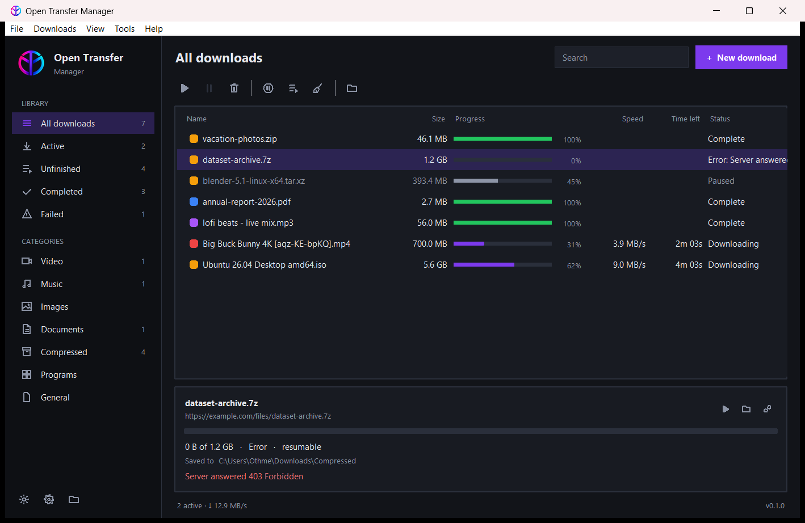

<div align="center">


# Open Transfer Manager

**A light, open-source download manager for Linux and macOS.**
Faster multi-connection downloads, videos from 1000+ sites, and a browser extension that just works.

[](https://github.com/OthmenBedoui/open-transfer-manager/actions/workflows/ci.yml)
[](LICENSE)




</div>

## Install

One command, no root needed for the app itself:

```bash
curl -fsSL https://raw.githubusercontent.com/OthmenBedoui/open-transfer-manager/main/install.sh | bash
```

The installer checks Python 3.9+ and Tk (and offers to install them), can add **ffmpeg**, installs the app in its own
folder, adds it to your applications menu (Linux) or `~/Applications` (macOS), and connects your browsers.

<details>
<summary>Other options</summary>

```bash
# unattended, with ffmpeg
curl -fsSL https://raw.githubusercontent.com/OthmenBedoui/open-transfer-manager/main/install.sh | bash -s -- --yes --with-ffmpeg

# from a clone
git clone https://github.com/OthmenBedoui/open-transfer-manager && cd open-transfer-manager && ./install.sh --local .

# with pip / pipx
pipx install git+https://github.com/OthmenBedoui/open-transfer-manager

# uninstall (keeps your settings; add --purge to remove them too)
curl -fsSL https://raw.githubusercontent.com/OthmenBedoui/open-transfer-manager/main/install.sh | bash -s -- --uninstall
```
</details>

## Features

| | |
|---|---|
| ⚡ **Multi-connection downloads** | Splits files into parts and downloads them in parallel; idle connections take over half of the slowest part. |
| ⏯️ **Pause & resume** | Even after closing the app or rebooting, when the server supports it. Automatic retries with back-off. |
| 🎬 **Video & audio from 1000+ sites** | YouTube, TikTok, Instagram, X, Facebook, Vimeo, Twitch, Reddit, SoundCloud… powered by [yt-dlp](https://github.com/yt-dlp/yt-dlp). Pick 4K/1080p/720p or audio only (mp3, m4a, opus, flac). Playlists too. |
| 🧩 **Browser extension** | Chrome, Brave, Edge, Opera, Vivaldi, Firefox (Safari planned). Captures downloads, adds “Download with OTM” to right-click menus, one-click “Download video from this page”, live progress in the popup. |
| 🌗 **Light & dark themes** | Follows your system, or choose one. |
| 🗂️ **Categories** | Video, Music, Images, Documents, Archives, Programs – each saved in its own folder. |
| 🕒 **Queue & scheduler** | Download N files at a time, start/stop the queue at set hours. |
| 🐢 **Speed limit** | Globally or per download. |
| 🪶 **Light** | Python standard library + Tk. The only dependency is yt-dlp. |
| 🖥️ **Command line & headless** | `otm add URL`, `otm list`, `otm headless` for servers/NAS. |
| 🔒 **Private** | No telemetry, no account, no ads. The browser bridge only listens on your own computer. |

## Browser extension

1. Install the app (the installer registers the bridge for every browser it finds; run `otm register-browsers` after installing a new browser).
2. Install the extension:
   - **Chrome / Brave / Edge / Opera / Vivaldi**: Chrome Web Store *(coming soon)* – or download `open-transfer-manager-chromium-*.zip` from [Releases](https://github.com/OthmenBedoui/open-transfer-manager/releases), unzip, open `chrome://extensions`, enable *Developer mode*, *Load unpacked*.
   - **Firefox**: Firefox Add-ons *(coming soon)* – or load `open-transfer-manager-firefox-*.zip` from `about:debugging`.
   - **Safari**: planned, see [docs/BROWSER_EXTENSIONS.md](docs/BROWSER_EXTENSIONS.md).

How it works and troubleshooting: [docs/BROWSER_EXTENSIONS.md](docs/BROWSER_EXTENSIONS.md).

## Command line

```text
otm                         open the app (or bring it to the front)
otm URL [URL...]            send links to the app
otm add URL --quality 720   add a video in 720p   (--media / --file / --later)
otm list                    list downloads
otm headless                run without a window (controlled by the extension)
otm doctor                  diagnostics for bug reports
otm update-ytdlp            update the video engine
otm register-browsers       connect the browser extension
```

Keyboard: `Ctrl/Cmd+N` new download · `Ctrl/Cmd+V` paste links · `Space` pause/resume · `Del` remove · `Ctrl/Cmd+F` search.

## FAQ

**A video site stopped working.** Sites change often. Run `otm update-ytdlp` (or *Settings → Video & audio → Update now*).

**Best quality is not used / mp3 is not available.** Install `ffmpeg` (the installer offers it).

**The window does not open on Wayland.** Tk needs XWayland, which is on by default in GNOME and KDE.

**Where are my settings?** Linux: `~/.local/share/open-transfer-manager` · macOS: `~/Library/Application Support/Open Transfer Manager`.

## Contributing

Bug reports, ideas and pull requests are welcome – see [CONTRIBUTING.md](CONTRIBUTING.md) and the [roadmap](ROADMAP.md).
Issues labelled [good first issue](https://github.com/OthmenBedoui/open-transfer-manager/labels/good%20first%20issue) are a nice place to start.

## Legal

Open Transfer Manager is a general-purpose tool. Only download content you have the right to download, and respect
the terms of the sites you use. Released under the [MIT License](LICENSE).
