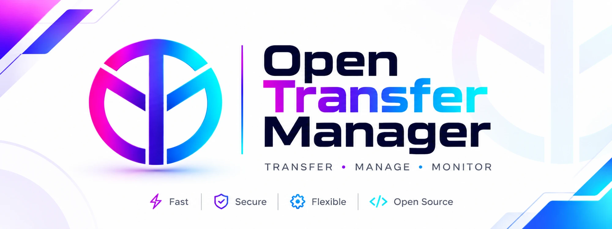
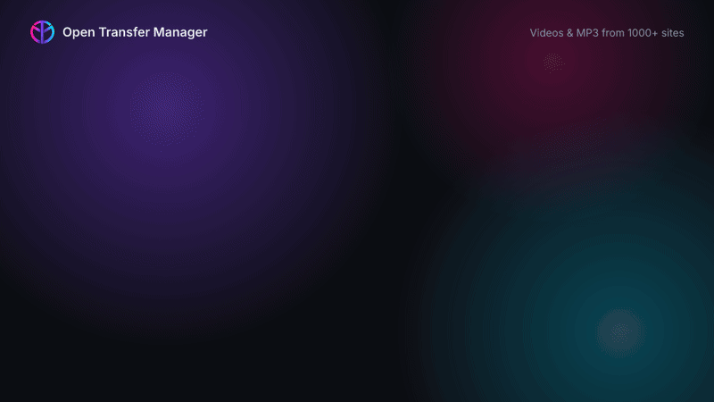
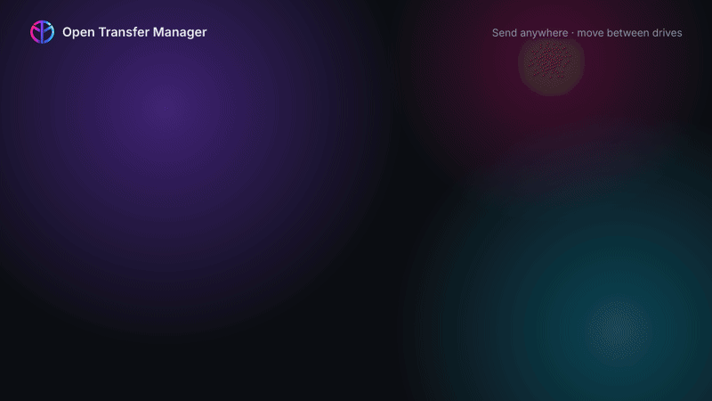

<p align="center">
  
</p>

<p align="center">
  A fast, light and open-source download manager for <b>Windows</b>, <b>Linux</b> and <b>macOS</b>.
</p>

<p align="center">
  
</p>

## Features

- **Fast downloads** — several connections per file, pause and resume.
- **Video and MP3** — from YouTube and 1000+ sites, choose the quality or MP3 (320 / 192 / 128 kbps).
- **Send anywhere** — drop files and upload them to Google Drive, OneDrive, Dropbox, MEGA, pCloud, Box, SFTP, FTP, WebDAV or S3, several at once — or move files between two drives.
- **Browser extension** — Chrome, Edge, Brave and Firefox: send downloads to the app, Download button on videos.
- **Organized** — files sorted by type (Video, Music, Documents…), queue, scheduler and speed limit.
- **Light and dark themes** — one small native app, no account, no ads, no tracking.

<p align="center">
  
</p>

## Install

One command per system. Each one installs the app **and everything it needs** —
yt-dlp (videos, MP3), ffmpeg (MP3, best quality) and rclone (Send, Transfer) — and checks
every download against its official SHA-256. All features are the same on Windows, Linux
and macOS. Every change is tested by a real install on all three systems
([CI](https://github.com/OthmenBedoui/open-transfer-manager/actions)).

### Windows 10 / 11

Open **PowerShell** (Start menu → type `PowerShell`) and paste:

```powershell
irm https://raw.githubusercontent.com/OthmenBedoui/open-transfer-manager/main/install.ps1 | iex
```

No administrator rights needed. Then open **Open Transfer Manager** from the Start menu.
You can also download `OTM-Setup-x.y.z.exe` from
[Releases](https://github.com/OthmenBedoui/open-transfer-manager/releases) and run it: it
installs the same tools (the "Download yt-dlp, ffmpeg and rclone" box is ticked).
Uninstall: Windows Settings → Apps → Open Transfer Manager (your downloads are kept).

### Linux and macOS

Open a terminal and paste:

```bash
curl -fsSL https://raw.githubusercontent.com/OthmenBedoui/open-transfer-manager/main/install.sh | bash
```

It installs the app for your user (`~/.local/bin/otm`, plus a menu entry on Linux or
`~/Applications` on macOS), connects your browsers, and installs yt-dlp, rclone and ffmpeg.
It asks before using `sudo` once, to install ffmpeg and `secret-tool` (keeps upload
passwords in your keyring) with your package manager; macOS uses Homebrew for ffmpeg.
Then open **Open Transfer Manager** from your menu, or type `otm`.

Works on **Ubuntu** 22.04+, **Linux Mint** 21+, **Pop!_OS**, **Zorin**, **elementary OS**,
**Debian** 12+, **Fedora**, **Arch**, **Manjaro**, **EndeavourOS**, **openSUSE** Tumbleweed,
and **macOS** on Apple Silicon (M1–M4). On other systems (Intel Mac, ARM, older
distributions) the installer offers to build the app from source.

Check that everything is there, on any system:

```bash
otm doctor
```

Reinstall or update the helper programs at any time: `otm install-tools`.

Uninstall (keeps your files and settings; add `--purge` to remove settings too):

```bash
curl -fsSL https://raw.githubusercontent.com/OthmenBedoui/open-transfer-manager/main/install.sh | bash -s -- --uninstall
```

<details>
<summary>Manual install (without the script)</summary>

1. Download `otm-linux-x86_64` (Linux) or `otm-macos-arm64` (macOS) from Releases, then:

```bash
cd ~/Downloads
mv otm-linux-x86_64 otm                 # or: mv otm-macos-arm64 otm
chmod +x otm
xattr -d com.apple.quarantine otm       # macOS only: the app is not signed yet
sudo mv otm /usr/local/bin/
otm                                     # start the app
```

2. Install the helper programs: `otm install-tools` (yt-dlp, rclone, and ffmpeg on
   Linux; on macOS install ffmpeg with [Homebrew](https://brew.sh): `brew install ffmpeg`).
3. Optional, Linux: your distribution's ffmpeg and `secret-tool`:

| Distribution | Command |
|---|---|
| **Ubuntu**, **Linux Mint**, **Pop!_OS**, **Zorin**, **elementary OS**, **Debian** | `sudo apt install ffmpeg libsecret-tools` |
| **Fedora** | `sudo dnf install ffmpeg-free libsecret` |
| **Arch**, **Manjaro**, **EndeavourOS** | `sudo pacman -S ffmpeg libsecret` |
| **openSUSE** Tumbleweed | `sudo zypper install ffmpeg` |

The ready-made Linux file needs a 64-bit PC with glibc 2.35 or newer. Older distributions
(Ubuntu 20.04, Debian 11, RHEL / Rocky / Alma 8–9, openSUSE Leap 15), Alpine and ARM
computers: see [Build from source](#build-from-source), or use the script, which builds for you.

</details>

## Use

1. Click **New download** (or paste a link with Ctrl+V / Cmd+V).
2. For a video page, choose a quality or **Audio only** for MP3.
3. Click **Download**. Files go to your Downloads folder, sorted by type.

Command line:

```bash
otm add https://example.com/file.zip           # download a file
otm add https://youtu.be/VIDEO_ID --mp3 192    # video to MP3
otm send build.zip --to prod-server,backup-s3  # upload to saved destinations
otm doctor                                     # check that everything is set up
```

### Send files

Open **Connectors**, add a server (SFTP, FTP/FTPS, WebDAV or S3-compatible) and click
**Test connection**. Then drop files on **Send**, tick one or more destinations and click
**Send**. Uploads run through [rclone](https://rclone.org); OTM installs it for you the
first time (checked against its published SHA-256). Passwords and keys stay in Windows
Credential Manager, the macOS Keychain or the Linux Secret Service.

**Transfer** copies files from one drive or server to others (Google Drive → OneDrive,
SFTP → S3…): browse the source, tick files or folders, pick the destinations. Data streams
through your computer and is never written to its disk.

> Netflix, Crunchyroll, Disney+, Prime Video, Spotify and other streaming services lock
> their videos with DRM. OTM does not remove DRM; it tells you so and points to the
> service's own offline download.

Service logos come from [Simple Icons](https://simpleicons.org) (CC0) and only identify the
services you connect to; the trademarks belong to their owners.

## Browser extension

Install the extension in your browser (see [the guide](docs/BROWSER_EXTENSIONS.md)).
The Windows setup and the Linux/macOS script connect it for you. If you install a new
browser later, run once:

```bash
otm register-browsers
```

## Build from source

For systems without a ready-made download (Intel Mac, older Linux, ARM).
Needs [Rust](https://rustup.rs) (stable) and Git.

On Linux, install the build tools first:

| Distribution | Command |
|---|---|
| Ubuntu / Debian / Mint | `sudo apt install build-essential pkg-config libxkbcommon-dev libwayland-dev libx11-dev libgl1-mesa-dev` |
| Fedora / RHEL / Rocky | `sudo dnf install gcc pkgconf libxkbcommon-devel wayland-devel libX11-devel mesa-libGL-devel` |
| Arch / Manjaro | `sudo pacman -S --needed base-devel libxkbcommon wayland libx11 mesa` |
| openSUSE | `sudo zypper install gcc pkgconf libxkbcommon-devel wayland-devel libX11-devel Mesa-libGL-devel` |

On macOS: `xcode-select --install`. Then, on any system:

```bash
git clone https://github.com/OthmenBedoui/open-transfer-manager
cd open-transfer-manager
cargo build --release
./target/release/otm
```

On Windows, `scripts/install-windows.ps1` builds the setup (see [docs/WINDOWS.md](docs/WINDOWS.md)).

## License

[MIT](LICENSE). Only download content you have the right to download.
Documentation en français : [docs/README.fr.md](docs/README.fr.md).
